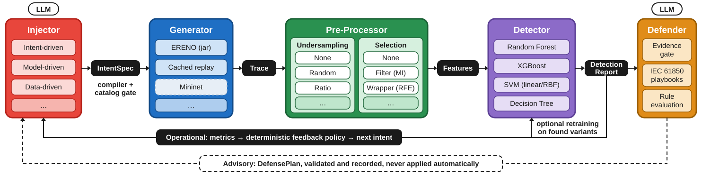

# ERENO-AI

**A multi-agent framework for generating IEC 61850 GOOSE attack variants and
stress-testing intrusion detectors against them.**

Intrusion detectors for digital substations are usually evaluated against one
fixed configuration per attack. A detector can score perfectly on that
configuration and still miss messages when the same attack's parameters change
(timing, altered fields, intensity). ERENO-AI explores those variations
systematically. It generates labeled GOOSE traffic with the
[ERENO](https://github.com/sequincozes/ereno-2.0) simulator, trains and scores a
detector on it, and reports what got through and why.

Two LLM agents sit at the edges of the loop. An **Injector** turns a request
into an attack intent, and a **Defender** drafts a defense plan from the
detection report. Everything in between is deterministic Python: compiling the
intent, generating traffic, preprocessing, scoring and validation. No LLM output
reaches the generator or the stored results without passing a validation gate.



## How it works

Each run is one pass through the pipeline:

1. **Injector (LLM).** Turns the input into a structured `IntentSpec`. The input
   can be a natural-language request (`intent`), an ERENO Java attack creator
   (`model`) or a profile of an existing trace (`data`).
2. **Compiler and catalog gate.** Compiles the intent into an ERENO attack
   configuration and rejects any field or value outside that attack's capability
   catalog. Values you dictate in the request are applied exactly or the run
   fails; they are never silently clamped.
3. **Generator.** Runs ERENO with a fixed seed to produce a labeled trace.
   `cached` mode replays a bundled dataset instead and needs no Java.
4. **Dataset gate.** Rejects traces that are empty, broken or too rare to
   measure (attack prevalence below 1%).
5. **Pre-processor.** Imputation, encoding, optional feature selection (mutual
   information or RFE) and optional undersampling. Each step is fitted on the
   training split only.
6. **Detector.** Random Forest (default), decision tree, linear or RBF SVM, or
   XGBoost, all plugged in at the same point of the pipeline.
7. **Defender (LLM).** Drafts a `DefensePlan`. The plan is rejected if it cites
   a metric or feature that is not in the report, alters a value, or recommends
   a technique that does not answer the evidence it cites. Accepted plans are
   recorded, never applied automatically.
8. **Feedback.** A deterministic policy reads the round's metrics and derives
   the next intent, first raising intensity and then changing more fields. No
   second LLM call is made.

The Mininet box in the figure is a planned back end. Today the implemented
generators are ERENO (`jar`) and cached replay.

**12 attacks are supported:**

| Key | Attack |
|---|---|
| `masquerade_fault` | Fake fault (masquerade) |
| `random_replay`, `inverse_replay` | Replay of captured messages, in random or inverse order |
| `injection`, `high_stnum` | Message injection, including injection with a high `stNum` |
| `flooding`, `grayhole` | Flooding and selective message dropping |
| `delayed_replay` and the variants `_backoff`, `_batch_dump`, `_double_drop` | Delayed replay |
| `programmable` | Your own behavior, written as declarative rules (mutate, select, shift timing, drop, duplicate) |

Baseline configurations live in [`inputs/attacks/`](inputs/attacks). The
editable fields and bounds of each attack are listed in
[`docs/attack_capabilities.md`](docs/attack_capabilities.md).

## Step-by-step guide

### 1. Install

You need Python ≥ 3.10 and [`uv`](https://docs.astral.sh/uv/).

```bash
git clone https://github.com/sequincozes/ereno-ai.git
cd ereno-ai
uv sync --extra dev --extra dashboard
```

Optional extras: `--extra xgboost` adds the XGBoost detector and `--extra shap`
adds SHAP explanations.

### 2. Check that everything works (no API key, no Java)

```bash
uv run pytest                            # full test suite (~1700 tests)
uv run adversarial-ids --iterations 2    # demo: replays a recorded run
```

The demo prints a one-line summary and writes its results to `outputs/`. If
both commands pass, the installation is good.

### 3. Add your Groq API key

The two agents call an LLM through [Groq](https://console.groq.com/). Copy the
example environment file and fill in your key:

```bash
cp .env.example .env              # PowerShell: Copy-Item .env.example .env
```

```env
GROQ_API_KEY=your-key-here
MODEL_ID=openai/gpt-oss-120b      # must be a model your Groq account serves
```

`.env` is gitignored. Never commit it.

### 4. Get the ERENO generator (only to generate new traffic)

Without the generator, every run uses the bundled dataset (`cached` mode). That
exercises the whole pipeline, but the traffic does not change with the attack
configuration, and only `masquerade_fault` can be measured. To generate real
variants you need Java 11+ and the ERENO jar.

Download the prebuilt jar from the
[latest release](https://github.com/sequincozes/ereno-ai/releases/latest):

```bash
curl -L -o generator_runtime/ereno-generator.jar \
  https://github.com/sequincozes/ereno-ai/releases/latest/download/ereno-generator.jar
```

Its SHA-256 is
`dfe25fd818178aea315b8a033963e3ab2591c1445462d6fe9c8fc63e5251658c`
(`sha256sum generator_runtime/ereno-generator.jar`; on PowerShell,
`Get-FileHash generator_runtime/ereno-generator.jar`).

Or build it yourself from the `feat/journal` branch of ERENO:

```bash
git clone -b feat/journal https://github.com/sequincozes/ereno-2.0.git ../ERENO-2.0
cd ../ERENO-2.0
./mvnw package -DskipTests        # Windows: mvnw.cmd package -DskipTests
cp target/ERENO-1.0-SNAPSHOT-uber.jar ../ereno-ai/generator_runtime/ereno-generator.jar
cd ../ereno-ai
```

When `generator_runtime/ereno-generator.jar` exists, the generator switches to
`jar` mode automatically. You can force either mode with `--generator-mode` or
`GENERATOR_MODE` in `.env`.

### 5. Run your first attack

Describe what you want in plain language. The Injector picks the attack and the
parameters from the catalog:

```bash
uv run adversarial-ids --engine intent --generator-mode jar \
  --prompt "evade the IDS with the high_stnum attack, using a stNum jump between 2 and 5"
```

The request can also dictate exact values (for example, "a duration between 50
and 80 ms"). Those values are checked against the catalog and applied exactly.

### 6. Read the results

Each run gets an ID and a folder `outputs/intent_loop/<run_id>/`:

| File | Contents |
|---|---|
| `intent.json` | What the Injector understood from your request |
| `attack_config.json` | The exact ERENO configuration that was generated |
| `detection_report.json` | Detector metrics (precision, recall, F1, confusion matrix) and the top features |
| `defense_plan.json` and `defense_rules.json` | The Defender's plan and the check of each action against the evidence |
| `feedback.json` | Whether the policy wants another round, and the next intent |
| `*_manifest.json` | Generator, seed, preprocessing, feature selection and detector used, for reproducibility |
| `events.jsonl` | Timeline of every stage transition |

All runs are also appended to `outputs/loop_records.json`. That ledger records
the status, duration, errors and token usage of every stage.

### 7. Let the loop iterate

```bash
uv run adversarial-ids --engine intent --generator-mode jar --rounds 3 \
  --prompt "reduce recall by varying the fault timing"
```

From round 2 on, the next intent comes from the feedback policy, not from a new
LLM call. The campaign stops early when the metric plateaus. If a campaign is
interrupted (quota, crash, Ctrl+C), resume it without repeating a finished
round:

```bash
uv run adversarial-ids --engine intent --resume <run_id>
```

To measure variance, run the same intent over several seeds with a single LLM
call. The result is reported as mean ± std:

```bash
uv run adversarial-ids --engine intent --generator-mode jar --replicates 5 --prompt "..."
```

### 8. Swap the pieces

```bash
# another detector: random_forest | decision_tree | svm_linear | svm_rbf | xgboost
uv run adversarial-ids --engine intent --detector xgboost --prompt "..."

# model-driven injector: the LLM reads an ERENO Java creator (needs ../ERENO-2.0)
uv run adversarial-ids --engine intent --generator-mode jar \
  --injector model --injector-source inverse_replay --prompt "..."

# data-driven injector: the LLM reads a profile of an existing trace
uv run adversarial-ids --engine intent --generator-mode jar \
  --injector data --injector-dataset path/to/trace.csv --prompt "..."
```

The `model` and `data` injectors author new behavior as rules for the
`programmable` attack, never as Java code. Preprocessing switches go in `.env`
and are documented in [`.env.example`](.env.example).

### 9. Use the web interface

```bash
uv run --extra dashboard streamlit run src/adversarial_ids/interfaces/dashboard/studio_app.py
```

Open <http://localhost:8501>. From there you can configure a run, start it,
follow the live timeline of stages and browse the results, all without the
terminal.

### 10. Reset

```bash
uv run python scripts/init_state.py --dry-run   # show what would be deleted
uv run python scripts/init_state.py             # wipe outputs/ and logs/ (data/ is never touched)
```

## Batch experiment scripts

For larger studies, `scripts/` has resumable batch runners that use the same
pipeline. Each one documents its steps in its header.

| Script | What it does |
|---|---|
| `run_e0_sensitivity.py` | Checks, field by field, whether each exposed attack parameter actually changes the generated traffic |
| `run_e1.py` | Compares search strategies (random, fixed schedule, LLM, LLM + Defender plans) under the same proposal budget |
| `run_e2.py` | Re-scores the variants found against other detectors |
| `run_e3.py` | Alternates attack rounds and detector retraining, with no-defense and placebo controls |
| `report_e6.py` | Token, call and time cost read from the logs of the runs above |
| `compare_detectors.py` | All detectors on one protocol, ranked |

Results go to `outputs/experiments/`.

## Project layout

```text
src/adversarial_ids/
├── domain/        frozen Pydantic contracts for each stage
├── agents/        injector / intent (LLM → IntentSpec), defender (LLM → DefensePlan),
│                  orchestrator (loop controller, campaigns, resume)
├── core/          intent compiler, generators, dataset gates, preprocessing, feature
│                  selection, undersampling, detectors, defense rules, feedback policy
├── config/        per-attack capability catalog, defense techniques, settings
├── experiments/   code shared by the batch scripts
├── interfaces/    CLI (adversarial-ids) and Streamlit apps
└── prompts/       versioned agent prompts
inputs/attacks/    baseline configuration of each attack
data/              bundled dataset and recorded demo run (never wiped)
generator_runtime/ ERENO jar (gitignored) and its configs
outputs/           run artifacts (gitignored)
```

[`docs/architecture.md`](docs/architecture.md) gives the architectural overview.
Deeper notes per component (generators, injectors, preprocessing, detectors,
defender validation, feedback policy, observability) are in [`docs/`](docs).

## Limitations

- All traffic is **synthetic**, generated by ERENO for a single substation
  configuration.
- In `cached` mode the dataset is the same in every round, so campaigns plateau
  at round 2. Use `jar` mode for meaningful results.
- LLM outputs vary between runs, and the free Groq tier has per-minute and daily
  token limits. A long campaign can stop on quota; resume it with `--resume`.
- `svm_rbf` scales quadratically with training size and exposes no feature
  importances.
