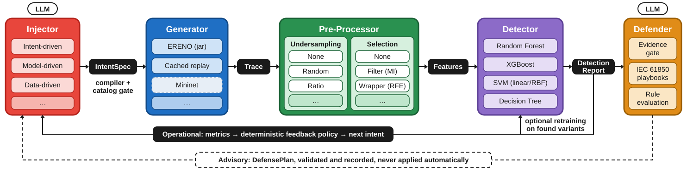
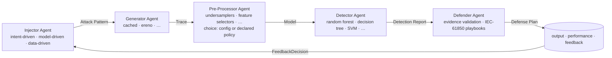

# Architecture — the five agents of the intent-driven pipeline

This is the target architecture of ERENO-AI and what the code implements today. It
fixes an omission in the diagram that circulated until 2026-10-01: the **Defender** is
the fifth box, between the Detector and the feedback — not a detail of the
feedback block.

## The design

The source is `docs/figures/architecture.svg` — versioned, editable as text and
exportable to PNG/PDF. The arrowheads are explicit polygons instead of
`marker-end`: not every renderer (svglib, some LaTeX/Inkscape pipelines)
draws markers, and a figure meant for publication has to survive the
renderer of whoever opens it. The `Mininet` box appears dashed and in gray
because it is **registered as absent** — it is a planned backend, not an implemented one.

The same drawing in Mermaid, for those who prefer to edit text:

## Why the Defender is a box, and not part of the feedback

The feedback block is **deterministic**: `core/feedback_policy.py` reads the
`DetectionReport` and the `DefensePlan` of the round and derives the next round's
intent without calling any LLM (epic E10). The Defender is something else — it is an **agent**,
with its own model, prompt and validator, which produces an artifact that nobody
else produces:

- `agents/defender/` generates a `DefensePlan` from the `DetectionReport`;
- `agents/defender/tools.py::validate_plan_against_report` rejects a plan that
  invents a metric or feature key, alters a value, points to another
  report, or declares a priority that the report does not support;
- `core/defense_rules.py`, over the catalog in `config/defense_techniques.py`,
  asks the next question: does each recommended technique **answer** the
  evidence that it itself cites? The result is persisted as
  `DefenseRuleReport`/`defense_rules.json`.

Collapsing this into "(output, performance, feedback)" would erase the only stage of the
pipeline in which an LLM output is confronted with the measured reality **and** with
a catalog of countermeasures — and that is half of the project's Red×Blue argument. See
`docs/defender_validation.md`.

## The stages, and what each one produces

| stage | produces | deterministic? |
|---|---|---|
| `intent` | `IntentSpec` | no — it is the LLM, behind two gates |
| `compiler` | `AttackCandidate` (the *Attack Pattern*) | yes |
| `generator` | the trace (CSV) | yes, given the backend and the seed |
| `preprocess` | `DatasetBundle` | yes |
| `detector` | `DetectionReport` | yes |
| `defender` | `DefensePlan` + `DefenseRuleReport` | no — it is the LLM, behind the validator |
| `feedback` | `FeedbackDecision` | yes |

Only **two** stages call an LLM, and both have a deterministic gate
right behind them. This is the project's central guardrail: the model produces the intent or the
defense plan; everything else is Python that decides whether that is executable.

### Note on the names (`schema_version` 2)

Up to v1 of the `LoopRecord`, `generator` named the **compilation** step and
`ereno` the generation one — a stage named after a backend inside an
architecture of pluggable backends. In v2 they are `compiler` and `generator`. v1
ledgers are refused with the reason; they live in `outputs/`, which is disposable.

## What is pluggable today, and what is not

| box | registered strategies | how it is chosen |
|---|---|---|
| Injector | `intent`, `model`, `data` | `--injector`, registry in `agents/injector/registry.py` |
| Generator | `cached`, `jar` | `--generator-mode`, registry in `core/generators.py` |
| Pre-Processor | selector `none`/`mutual_info`/`rfe`; undersampler `none`/`random`/`ratio` | env var **or** declared policy; **off** by default |
| Detector | `random_forest`, `decision_tree`, `svm_linear`, `svm_rbf` | `--detector`, registry in `core/detectors.py` |
| Defender | one | — |

Two honest remarks about this table:

**The Injector is a registry inside the intent-driven pipeline** (since 2026-10-13).
The three strategies produce the same `IntentSpec` and go through the same
gates; what separates them is the context the LLM reads — the catalog (`intent`), the
Java creator of an attack (`model`) or the profile of a trace (`data`). `model` and
`data` only propose new attacks in the `programmable` DSL, never code: see
`docs/injectors.md`. `--engine` still chooses the **pipeline** (`demo` is
golden replay, `live` is the legacy Strategist↔Analyst loop, which keeps
writing `IterationRecord`); `--injector` chooses the strategy inside
`intent`.

**The Pre-Processor decides half.** The undersampler has a real decider
since 2026-10-01: `UNDERSAMPLING_MODE=policy` hands the choice to a declared
rule (`core/undersampling_policy.py`) that resolves the strategy from the
imbalance of the train split, and records who decided, over what measure and
why in the `SelectionManifest`. The feature selector is still only
`FEATURE_SELECTION_MODE`, an environment key.

The condition the caveat imposed was met to the letter — the decision is auditable
and stays **outside** what the loop optimizes, and that is structural, not documentary:
`decide_undersampling(*, class_counts, mode, policy)` has no way to receive
a `DetectionReport`, a `Metrics` or an `IntentSpec`, and a test checks the
signature. There is no `feedback` or `intent` decider, and that is not a postponement: a
loop that tunes its own preprocessing until the metric improves stops
measuring what the detector faces, and letting the attacker's intent configure the
defender's training is weakening the detector by a path that is not the attack.

## Provenance of a round

Four manifests written side by side in the execution directory answer, from the
artifacts and without re-running anything, where each number came from:

| file | answers |
|---|---|
| `generator_manifest.json` | where the trace came from, with what seed, whether it **varies with the config** |
| `feature_manifest.json` (E6) | how the features were prepared, over which rows |
| `selection_manifest.json` (E7) | which ones survived, before and after undersampling |
| `detector_manifest.json` (E8) | which model learned, with which hyperparameters and which scaling |

Alongside them, `dataset_bundle.json` says *what is* in the trace and
`detection_report.json` says *how well* the detector did. The split is deliberate: the
manifests describe the process, the reports describe the result, and only the
two together make a difference between executions attributable to something.

## Principles

- separation between domain, core, agents and interfaces;
- Pydantic models as contracts between the layers;
- interfaces depend on a port (`ExperimentRunner`), not on Agno details;
- cached mode for reproducibility without Java;
- fixtures and stubs explicitly identified as test resources;
- secrets kept out of version control.

## Execution modes

| mode | how it is invoked | dependencies |
|---|---|---|
| Cached golden | `--engine demo` (default) | nothing beyond Python |
| Legacy Strategist↔Analyst loop | `--engine live` | Agno, Groq |
| Legacy loop without an Agno team | `--engine live --orchestration direct` | Agno, Groq |
| Intent-driven pipeline | `--engine intent --prompt "..."` | Agno, Groq |
| Physical generation | `--generator-mode jar` | Java + the ERENO JAR |

The first three produce `IterationRecord`; the intent-driven one produces
`LoopRecord`, which is a different contract and does not go through the `ExperimentRunner`.

## External dependencies

| dependency | use |
|---|---|
| Agno | abstraction of the agents and the team |
| Groq | inference for the real agents |
| pandas | datasets and tables |
| scikit-learn | detectors, preprocessing and metrics |
| Pydantic | domain contracts |
| Streamlit (`--extra dashboard`) | dashboards |
| SHAP (`--extra shap`) | optional explanations, for tree detectors only |
| Java + ERENO JAR | generation outside cached mode |

## Architectural decisions

- the `src/` layout avoids accidental imports from the root;
- `ExperimentRunner` decouples the interfaces from the workflow;
- the golden allows demonstrating and testing without Groq or Java;
- presentation code does not train models or execute agents;
- each pluggable strategy (generator, detector) is a registry by key with a
  per-execution manifest, and not a chain of `if`s.
